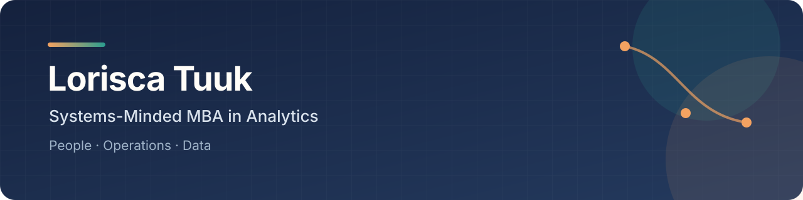

**Operations and people systems, with the analytics to prove they work.**

At Bank Mega I rebuilt a fragmented recruiting process into one source of truth: hiring turnaround down ~**80%**, admin work down ~**60%**, on 10,000+ CVs a year. The same problem keeps finding me across banking, food tech, logistics and analytics. A process grows, the information scatters, and the team spends its time chasing updates instead of deciding. I trace where the work breaks, rebuild the flow, and leave behind a system people keep using.

**Open to:** business operations, people analytics, chief of staff and operations roles where the work is still taking shape. Based in San Francisco.

**Start here:** [One intake door and mass interview engine](https://github.com/lorisca-analytics/recruitment-front-door) · [AI everywhere, without automating the moat](https://github.com/lorisca-analytics/relay-ai-transformation) · [Why accidents rose at every site](https://github.com/lorisca-analytics/people-analytics-r)

## Problems I'm useful for

| When the work looks like this | What I bring |
| --- | --- |
| A process depends on manual follow-ups and scattered files | I map the handoffs, remove repeated work, and build one usable workflow |
| The data exists, but nobody trusts or uses it | I define the measurement logic and turn it into decision-ready reporting |
| Teams keep losing information between functions | I make ownership, status, and next actions visible |
| AI is being added without a clear operating purpose | I test what the system actually does and design the human checks around it |

## Work

### Case studies: [lorisca-analytics.github.io](https://lorisca-analytics.github.io)

<!-- REPOS:START:lorisca-analytics -->
- **[Which Employers Reliably Sponsor H-1B Business Roles](https://github.com/lorisca-analytics/h1b-sponsorship-sql-analysis)** - SQL analysis of 3.47M H-1B filings (2020–2023). The business-role wage premium survives on medians, then breaks honestly when IT managers are excluded.
- **[Massachusetts H-1B Analysis](https://github.com/lorisca-analytics/massachusetts-h1b-analysis)** - Reading the Massachusetts labor market through five years of public H-1B filing data: which employers sponsor repeatedly, and do business roles pay as well as a…
- **[Where Should We Spend the Next Ad Dollar?](https://github.com/lorisca-analytics/superstore-discount-ceiling)** - A marketing analytics lead has an ad budget and a room full of managers who read the business through sales volume.
- **[Delivery Economics](https://github.com/lorisca-analytics/delivery-economics-dashboard)** - A white-glove delivery operation losing $1,156 on 13 orders.
- **[The Bounce-Back](https://github.com/lorisca-analytics/bike-venture-turnaround)** - A marketing performance audit that pulled a team out of a Q3 collapse and back to profitability by Q6.
- **[Gig Worker Referral Platform](https://github.com/lorisca-analytics/gig-worker-referral-platform)** - The bank already banks these people. It just can't see their income.
<!-- REPOS:END -->
- *More land here as they're published. Professional systems are being written up now.*

### Builds: [lorisca-builds.github.io](https://lorisca-builds.github.io)

<!-- REPOS:START:lorisca-builds -->
- **[Open Loops Board](https://github.com/lorisca-builds/muse-adhd-project-manager)** - A scheduled scan that catches everything I leave midway across AI chats and lands it on one prioritized board.
- **[Claude Skills](https://github.com/lorisca-builds/lori-claude-skills)** - Twelve skills I built for Claude, each from a failure I got tired of repeating.
- **[The CMS behind this site](https://github.com/lori-sca/lori-sca.github.io)** - My portfolio runs on plain HTML and JSON, and I edit every word of it from a custom admin panel, no developer needed.
<!-- REPOS:END -->
- *New builds get added as they ship.*

### Selected systems

- **Mass recruitment, one source of truth:** turnaround −80%, admin −60%.
- **Attrition was a promotion problem:** turnover down ~15% in 2023, ~17% in 2024.
- **AI prototype audit:** a demo presented as AI-enabled made no model calls. I proved it, then designed the fix.
- **Merchant onboarding, standardized:** six specialists, Looker visibility, onboarding down ~3 days.

## How I think about the work

I care whether a metric changes a decision and whether a workflow still works after its builder leaves. In people analytics, I use data for insight rather than surveillance. In AI work, I check what the system actually does before calling it intelligent.

I work between business and technical language: rigorous enough to follow the technical side, fluent enough to translate it for whoever has to act on it. That's why I did an MBA in Analytics.

## Stack

I pick tools on principle, not loyalty. Current defaults:

AI-native workflow:

